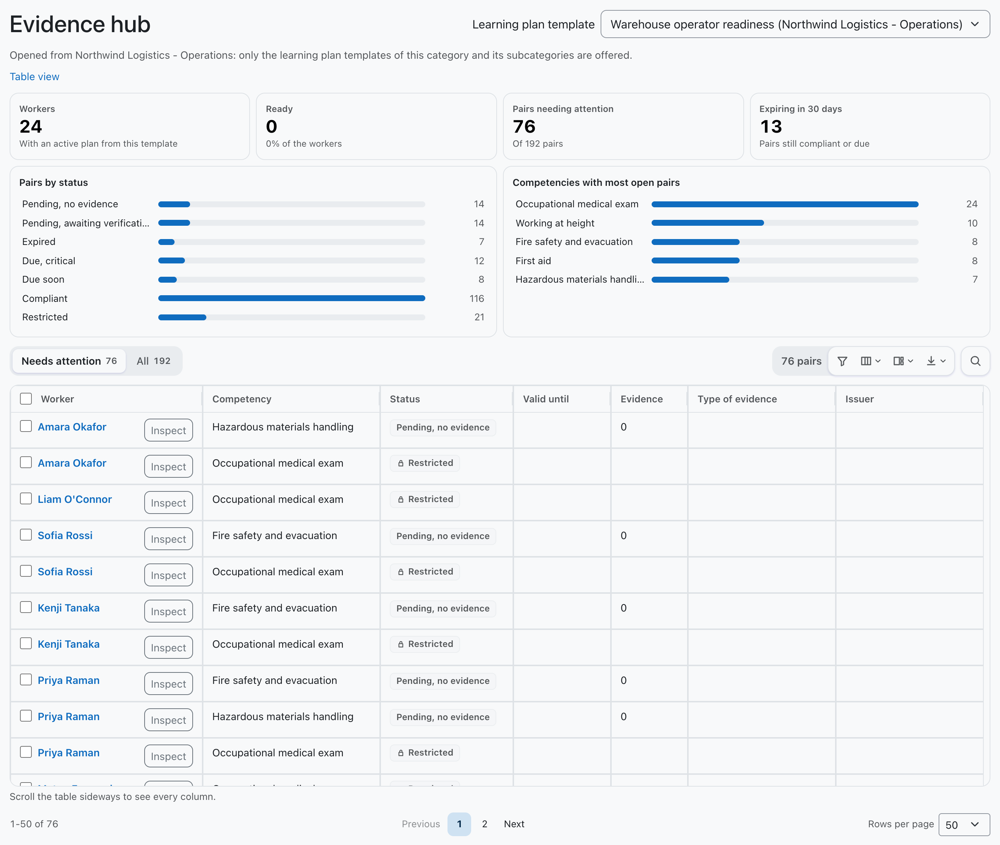
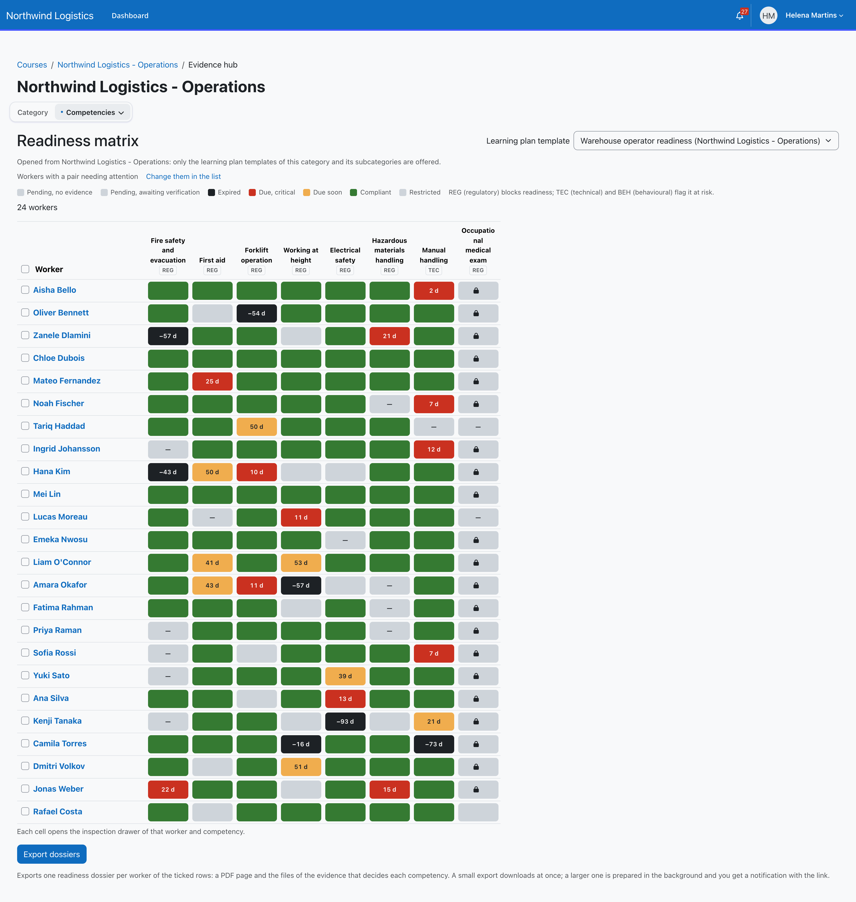
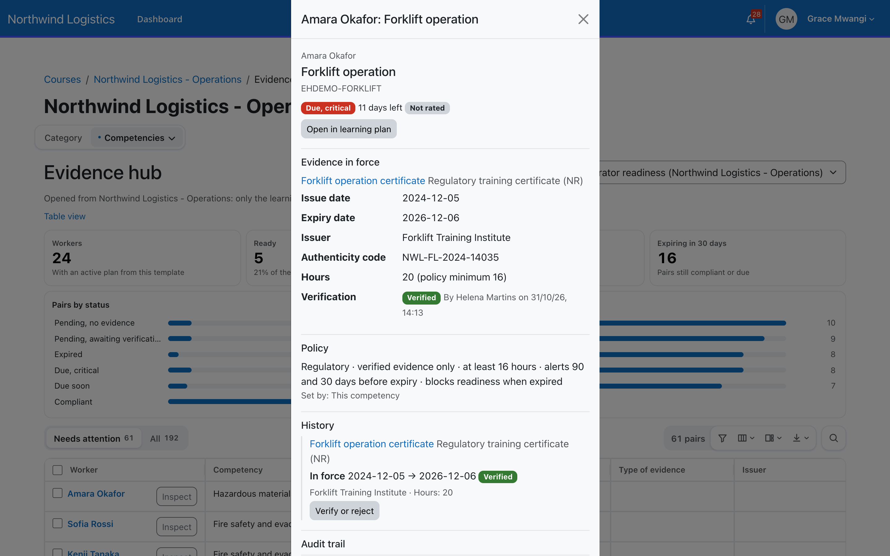
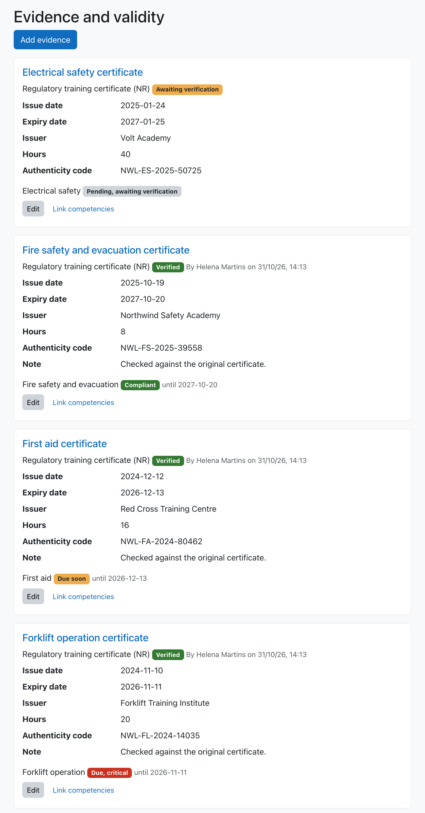
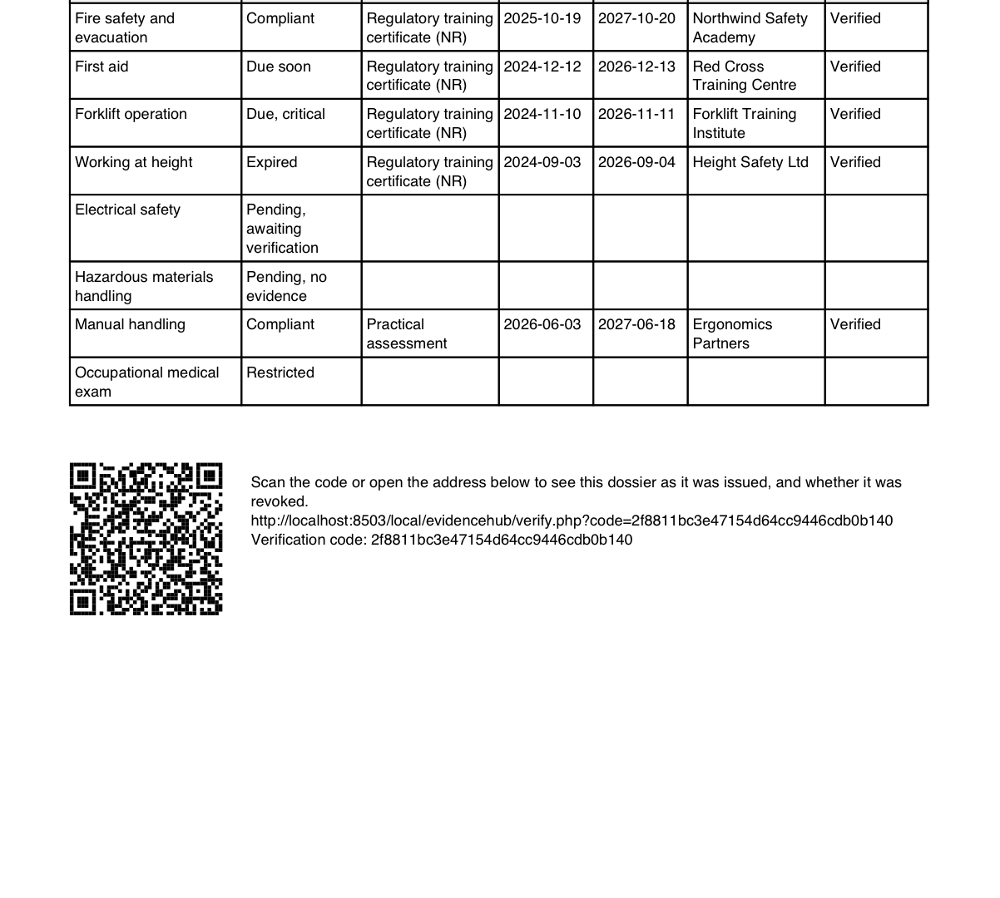
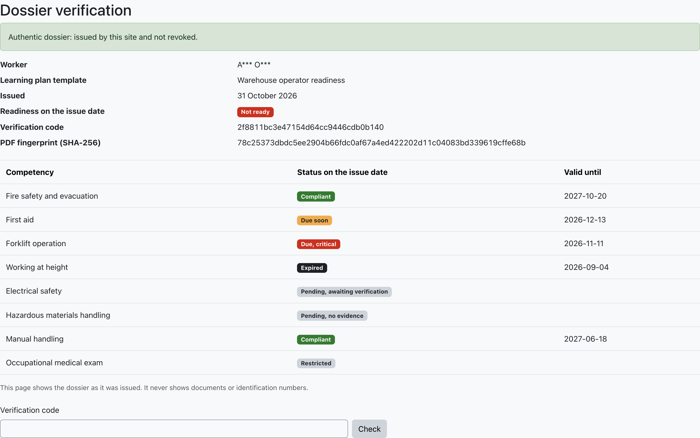
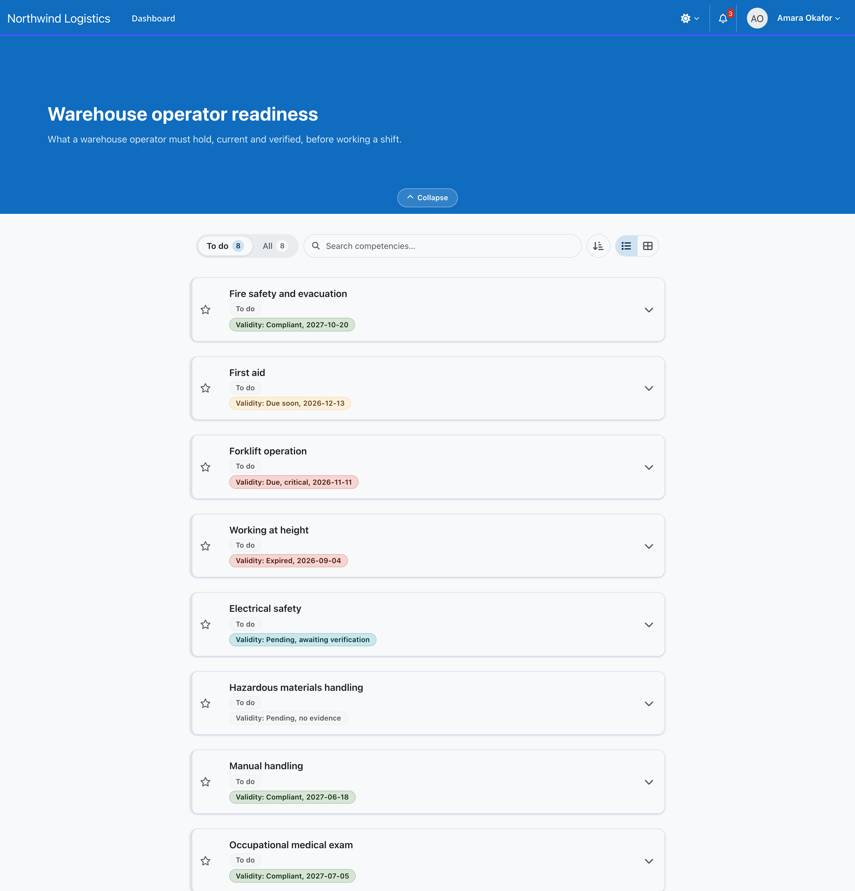
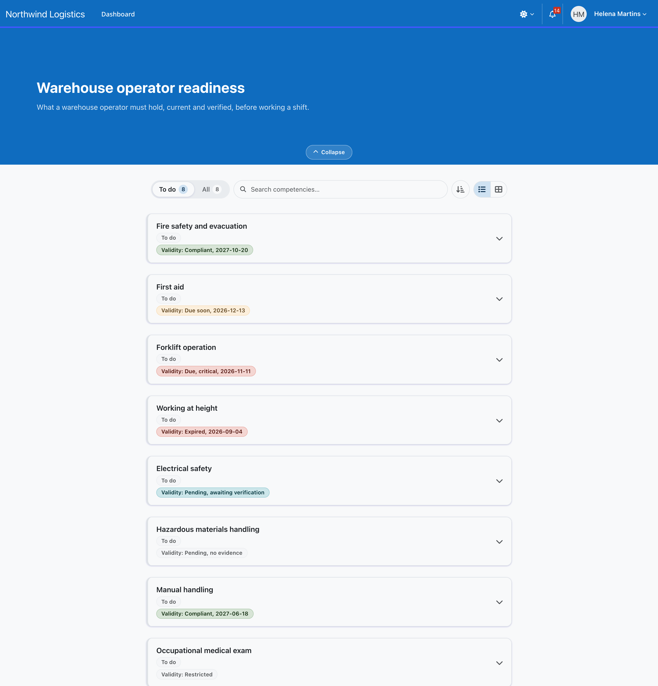
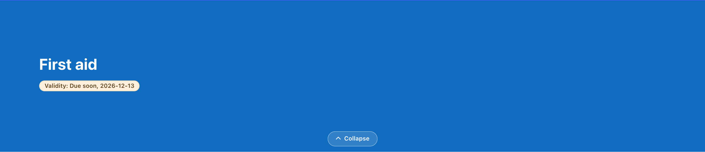

moodle-local_evidencehub
========================

Validity of competency evidence, readiness per learning plan template, and verifiable dossiers.

Core competencies let a worker upload evidence of prior learning (a training certificate, a health
certificate, a diploma) and link it to competencies, but the evidence has no issue date, no expiry
and no type. This plugin adds those details to core's own evidence, works out from them whether
each competency a plan template requires is compliant, due, expired or pending for each worker,
and lets a manager export a ZIP of readiness dossiers whose PDF pages carry a verification code.

The evidence itself stays core's (`competency_userevidence` and its files): the plugin keeps the
details beside it in tables of its own and never changes a core rating. It is developed in stages;
this release holds the data model, the capabilities, the privacy provider, the evidence details
(entering, verifying and rejecting them), the validity engine with its policies, the hub with its
readiness matrix and its inspection drawer, and the readiness dossiers with their public verification
page, the alerts and the readiness web service, and the validity pills on the learner views of
`local_dimensions`.

Screenshots
-----------

*Moodle 5.3 with the Dimensions theme and demo data: one category, a "Warehouse operator readiness"
template of eight safety competencies, and 24 workers. The manager has no
`local/evidencehub:viewsensitive`; the HR reviewer has it.*

### The evidence hub

One template at a time, opened from its category. The cards count the pairs in each status, and
"Ready" counts the workers whose every pair is compliant or due. The grid starts on
**Needs attention**. The manager sees the occupational medical exams as "Restricted", because the
type that decides them is sensitive.

### The readiness matrix

The same filter, one row per worker. A cell shows the days left (or, negative, overdue) when a date
matters, and a padlock when the pair is restricted to this viewer. Each column is headed by the
kind of the competency's validity policy (REG, TEC, BEH).

### The inspection drawer

"Inspect" opens one pair: the evidence that decides it, the policy that applies and where it was set,
the history of earlier evidence, and the audit trail. A reviewer verifies or rejects from here.

### The worker's evidence page

### Readiness dossier and its verification page

The PDF is what the requester may see. The public page behind its QR code shows only the dossier's
snapshot: a masked name, no identifier and no file, and "Restricted" for a sensitive competency
whoever issued it.

### Validity pills in local_dimensions

With `local_dimensions` installed, its plan overview and its tracker show one pill per competency.
The worker sees their own medical exam with its date; the manager sees "Restricted". A competency
with no evidence shows "Pending, no evidence" only because an explicit policy covers it.

Requirements
------------

- Moodle 5.3 (`$plugin->supported = [503, 503]`)
- Competencies enabled (`core_competency/enabled`), with learning plan templates (`tool_lp`, part
  of core)
- Optional: `tool_cohortroles` (part of core) to give mentors the user-context capabilities over
  the workers of their cohorts
- Optional: `local_dimensions` (5.3) to show validity pills on its plan overview and competency
  tracker; neither plugin requires the other

Installation
------------

Install the plugin like any other plugin to folder `/local/evidencehub`.

See http://docs.moodle.org/en/Installing_plugins for details on installing
Moodle plugins.

The installation seeds five evidence types: regulatory training certificate (NR), occupational
health certificate (ASO, marked sensitive), technical responsibility record (ART/RRT), diploma and
practical assessment. Their names are stored in the language of the site at installation and can
be changed.

Usage
-----

**The evidence page** (`/local/evidencehub/evidence.php?userid=<id>`, the current user by
default) lists a worker's evidence of prior learning with its validity details: type, issue and
expiry dates, issuer, hours, the authenticity code (to who may manage or verify the evidence) and
the verification state with who decided and when. Reading it follows core: a user who can view the
worker's evidence in tool_lp (`moodle/competency:userevidenceview` in the worker's user context, or
the right to manage it) can open the page. From it:

- "Add evidence" and "Edit" open one form that saves core's evidence (name, description, URL,
  files, through core's API) and its validity details together, or neither.
- "Complete details" adds the details to an evidence entered in tool_lp.
- "Verify or reject" records a verifier's decision; a rejection needs a note, which the worker
  sees.
- "Link competencies" opens the evidence in tool_lp, where competencies are linked.

Each type sets rules: an expiry date is required (or "Never expires" is refused), an authenticity
code is required, and a default validity in months fills a missing expiry date from the issue date
(the last day of a shorter month when the day does not exist). A type with no default validity
needs an expiry date or "Never expires".

Evidence of a **sensitive** type (the occupational health certificate) shows only its type and
"Restricted details" to a viewer other than the worker who lacks `local/evidencehub:viewsensitive`.
Such a viewer can neither edit nor verify or reject those details, whatever else they hold; a
manager without it can still enter a new evidence of a sensitive type.

**On tool_lp's evidence pages** (the list of a user's evidence and the view of one) whoever may
manage the evidence sees a prompt linking to the evidence page while some evidence has no validity
details.

**Nobody verifies their own evidence.** The owner of an evidence can never verify or reject it,
whatever their capabilities.

**An edit sends a decision back to pending.** When the details or the core evidence of a verified
or rejected evidence change (in this plugin's form or in tool_lp), the evidence returns to
"Awaiting verification", unless the change came from a holder of `local/evidencehub:verify` who is
not the owner. Every entry, change, decision and reset is written to the audit trail.

**Validity.** For each (worker, competency) pair the plugin works out a status from the evidence
linked to the competency in tool_lp and from the competency's validity policy, and keeps it in
`local_evidencehub_status`:

- *Compliant*: a counted evidence covers today with more days left than the policy's first alert.
- *Due soon* / *Due, critical*: covered, within the first / second alert window (days before the
  last valid day).
- *Expired*: counted evidence exists and none covers today.
- *Pending, awaiting verification*: evidence exists but none counts yet (no details, not verified
  where the policy requires it, too few hours, refused by a verifier, or issued in the future).
- A pair with nothing at all has no row: it shows as *Pending, no evidence*.

Dates are calendar days in the site's timezone; the expiry day itself is still valid. Among several
covering evidence the one with the latest last valid day decides. The status is recomputed when an
evidence is linked or unlinked, its details change, it is verified or rejected, or the competency is
rated; the evidence page shows it next to each linked competency.

**Validity policies** (Site administration > Competencies > Validity policies,
`/local/evidencehub/policies.php`) are set per competency framework, and a competency can override
its framework. A holder of `local/evidencehub:managepolicies` in a framework's context (the system
or a course category) manages that framework's policies; a category manager sees only the
frameworks of their categories. Without a policy, a competency is technical with alerts at 60 and
30 days. A policy says:

- its kind: *regulatory* (only evidence counts, a new policy counts verified evidence only, expiry is
  strict and an expired competency blocks the worker), *technical* (evidence or the latest
  proficient rating counts, with optional grace days after expiry and optionally only while the
  competency is rated proficient) or *behavioural* (only the latest proficient rating counts, for
  the number of months the policy sets; 0 means it never expires);
- whether only verified evidence counts, the minimum hours an evidence must state, the two alert
  windows, and what happens on expiry: the expiry is always written into the competency's history,
  and the *review* choice also asks core competencies for a review. The plugin never changes a
  rating or a proficiency.

A policy change recomputes its framework's or competency's pairs in an ad hoc task.

Core loads the plugin's admin entries only for users who can see the site administration, so a
category manager never sees the "Validity policies" entry: they open
`/local/evidencehub/policies.php` directly, which lists the frameworks of their categories.

On the evidence page, a competency whose validity is decided by an evidence of a sensitive type
shows only "Restricted", on every evidence linked to it, to a viewer who may not see that evidence.

**The evidence hub** (`/local/evidencehub/index.php`) shows, for one learning plan template, every
(worker, competency) pair of the workers with an active plan from it: the status, the last valid
day, how many evidence records were considered, and the type and issuer of the deciding evidence.
It has two entries:

- Site administration > Competencies > Evidence hub, which offers every template;
- a course category's More menu ("Evidence hub"), which offers only the templates of that category
  and its subcategories. A category manager uses this one: core loads the site administration
  entries only for users who can see the site administration.

Opening the hub needs `local/evidencehub:view` in its context, and a template is offered only when
the viewer can read it (`moodle/competency:templateview`). Each row also needs core's
`moodle/competency:userevidenceview` in the worker's user context: a category manager needs it for
the workers of their team, typically through `tool_cohortroles` (a role holding it, assigned over
the team's cohort). The hub says how many of the template's workers are hidden by permissions:
every worker with an active plan from the template whom the viewer may not see, whatever the cohort,
suspended or search filter, so changing a filter tells nothing about those workers.

Above the grid, one tile per status counts the pairs and their share, with the readiness rate (the
workers whose every pair is compliant or due); a tile or a status chip toggles that status. The
default view, "needs attention", shows every status except compliant, the most urgent first:
pending and restricted pairs, then by the last valid day. A cohort, a search on the worker's name
(and on the ID number when the viewer is shown it as an identity field), "Include suspended" and the
page size narrow the grid; every view is a URL, and the last filter shown is kept as a user preference
and restored when the hub is opened without one (a download stores none). The rows
of the filter, or only the ticked ones, download in any of the site's data formats.

A pair decided by an evidence of a sensitive type reads "Restricted", with no date, evidence count,
type or issuer,
to a viewer who is not the worker and lacks `local/evidencehub:viewsensitive` in the worker's user
context; the status filters, the sort, the tiles and the download treat it as its own status, so
none of them reveals what the cell hides.

**The readiness matrix.** A tab beside the list ("List", "Matrix") shows the same filter as one row per
worker and one column per competency of the template, in the template's own order, each column
headed by the competency's short name and the kind of its validity policy (REG regulatory, TEC
technical, BEH behavioural). A legend above the table names each status's colour. A cell is the
pair's status as a coloured square, with the days left while it is due, the days since it expired, a
dash when no evidence exists and a lock when it is restricted (no number then); each cell opens the
pair's inspection drawer. The status chips keep the workers with at least one pair in the chosen
statuses, whose rows still show every competency; the rows sort by name or, by default, most urgent
first (the earliest last valid day among the worker's pairs not compliant), 25, 50 or 100 workers a
page. The first column, with the worker's name, the identity fields the page shows and a checkbox
selecting the worker (for the dossiers), stays in place while the table scrolls
sideways. The matrix
reads the same pairs, access rules and restriction as the list, and its view is kept with the rest
of the filter.

**The inspection drawer.** Each row of the grid, and each cell of the matrix, has an "Inspect" button that opens a side sheet
for that worker and competency. Its content is loaded from the server, which checks again that the
viewer holds `local/evidencehub:view` in the hub's context, may read the worker's evidence
(`moodle/competency:userevidenceview`) and the competency (core's `competencyview`). It shows the worker, the competency and its status (with
the days left), core's proficiency to who may read the worker's user competencies, the evidence in
force (type, dates, issuer, hours against the policy's minimum, verification, its files as download
links served by core, and the authenticity code to managers and verifiers only), the policy that
applies and where it is set, every evidence of the worker linked to the competency as a timeline
(newest first, each with its interval, state, issuer and hours, and the gap in days to the next
record when they do not touch), the audit trail of those evidence records (notes only to the worker
and to verifiers), and when the status was computed and its next change. An evidence of a sensitive
type shows only its type and "Restricted details" to a viewer who is not the worker and lacks
`local/evidencehub:viewsensitive`, and its audit rows only their date and action; when such an
evidence decides the pair, the section is headed "Deciding evidence" whether or not it is in force.

From the drawer, each action shows only to who may take it, and the form it opens checks again:
"Verify or reject" (verifiers, never on their own evidence), "Edit details" (who may manage the
worker's evidence), "Open in learning plan" (the worker's plan from the hub's template, when the
template requires the competency and the viewer may read the plan), and
**Register recycling**: a new evidence for the same competency, with the type and issuer of the
latest one copied, which on save is linked to the competency through core and recomputes the
pair. Earlier evidence is never rewritten: a recycling adds a record to the timeline.

**Readiness dossiers.** A holder of `local/evidencehub:exportdossier` and `local/evidencehub:view` in
the hub's context sees "Export dossiers" under the list and the matrix. It exports one dossier per worker
of the ticked rows (the list's pairs give their workers), checked on the server against the filter's
rows as the requester sees them: a worker outside them is dropped, and a selection of more workers than
`maxexportworkers` is refused. Each dossier is built as the requester: the hub's capabilities in its
context, the template offered there, and core's `moodle/competency:userevidenceview` in each worker's
user context. A worker who fails a check (or no longer has an active plan from the template) is left
out and listed in the manifest as "not available", with no reason.

The ZIP holds `manifest.csv` (the path, size and SHA-256 of every file, and the workers left out) and a
folder per worker, `<identifier>_<last name>-<first name>/`, with:

- `<identifier>_dossier.pdf`: one page with the site's name and logo, the worker's full name and
  identifier, the template, the issue date, a table of the template's competencies (status as the
  requester sees it, type of the deciding evidence, issue and expiry dates, issuer, verification), the
  readiness on the issue date (ready; not ready when a competency under a regulatory policy is not
  compliant, due or critical; at risk when only technical or behavioural ones are), and a QR code to the
  verification page with the code printed beside it;
- the files of the evidence that decides each competency, named
  `<identifier>_<competency ID number>_<expiry YYYY-MM-DD or never>_<original name>`, with a counter on a
  clash.

**Sensitive files stay out by default.** The files of an evidence of a sensitive type are never in a
dossier unless the setting `includesensitivefiles` is on **and** the requester holds
`local/evidencehub:viewsensitive` in the worker's user context; its PDF row shows its type and validity
only to a requester who may see it, "Restricted" otherwise. Note that core serves an evidence's files to
anyone holding `moodle/competency:userevidenceview` over the worker: on this site that capability is
effectively access to health data, and should be granted with that in mind.

The identifier is the user's ID number, or a custom profile field of the text type chosen in
`identifierfield` (a national identification number, for example); a worker without a value is "u" and
the user id. It is printed in the PDF and the file names only, never on the verification page.

An export of at most `syncmaxworkers` workers whose files weigh at most `syncmaxbytes` downloads at once
and nothing is kept on the site. A larger one is prepared in the background by an ad hoc task running
as the requester, stored in the requester's user context, and announced by a notification ("Readiness
dossiers prepared in the background") with the link; only the requester can download it, for
`exportretentiondays` days, while they still hold `local/evidencehub:exportdossier` and
`local/evidencehub:view` in the hub's context the export was made in, and still read the evidence of every
worker it holds a dossier about. A failure is notified too. In `manifest.csv`, a cell starting with `=`,
`+`, `-`, `@`, a tab or a carriage return gets a leading single quote, so a spreadsheet never reads it as a
formula.

**The verification page** (`/local/evidencehub/verify.php?code=<code>`) is public by default: who may open it
is decided by `local/evidencehub:verifydossier`, as `tool/certificate:verify` decides for certificates. A
visitor who is not logged in is checked as the guest role, which holds it by default, so the page works on a
site that forces login and for a contractor without an account; a site that prevents it for guest asks such a
visitor to log in, and one that prevents it for authenticated users too limits it to the roles it grants it to.
It tells search engines not to index it. The code is 128 random bits; anything else reads "not found", as an
unknown code does. The page shows the dossier as issued: the masked name ("J*** S***", the first letter of
each part of the name), the template, the issue date, each competency's status and expiry on that date
("Restricted", with no date, for one decided by evidence of a sensitive type, whoever issued the dossier),
the readiness on that date (by default the worker's real one: certifying it is what a dossier is for; under the
`readinessbasis` setting "shown", the one over the statuses the page shows, where "Restricted" counts as not
met, and no verdict at all for a dossier issued before the snapshot kept it), the SHA-256 of the issued PDF (to compare with the file a contractor holds). A revoked
dossier's page says only that it was revoked, and on which day. It never shows the identifier, the full name or a file, and it logs nothing. With
`verifylive` on, it also shows each competency's status today, read with no rights at all: a competency
decided by sensitive evidence reads "Restricted".

**Shared dossiers.** The worker's evidence page lists every dossier issued about them: when, by whom, for
which template, and whether it was revoked. The dossier's creator, or a holder of
`local/evidencehub:exportdossier` in the system context, can revoke it there; its verification page then
says so, and shows nothing else.

**Custom reports.** The report builder datasource "Competency validity" (one row per stored status,
with the deciding evidence, the worker and the competency) is offered to holders of
`local/evidencehub:view` in the system context. Its rows follow the hub's rules for the user the
report is built for (the viewer, or for a schedule the creator, a chosen user or each recipient):
only workers whose user context grants that user `moodle/competency:userevidenceview`, and a pair
whose deciding evidence is of a sensitive type reads "Restricted" in its status, dates, evidence
count, type, issuer and verification, unless the user is the worker or holds
`local/evidencehub:viewsensitive` in the worker's user context. Filters and sorting read the same
restricted values.

**Core competency history.** Each status change writes one log entry ("Evidence hub: ...") into the
history of the worker's user competency (`competency_evidence`, through core's `add_evidence()`,
with the plugin's component): core's own privacy provider exports and deletes those entries with the
rest of the competency history.

**Tasks.**

- *Evaluate validity transitions* (`\local_evidencehub\task\evaluate_validity`, hourly): recomputes
  the statuses whose next transition (an alert window, the expiry, a renewal starting) has come,
  500 per run, oldest first.
- *Reconcile validity statuses* (`\local_evidencehub\task\reconcile_validity`, weekly on Sunday
  night): recomputes every pair that has a linked evidence, a status or a proficient rating that
  counts, healing whatever a missed event left behind.
- *Recompute validity after a policy change* (`\local_evidencehub\task\recompute_scope`, ad hoc).
- *Prepare readiness dossiers* (`\local_evidencehub\task\build_dossier_export`, ad hoc, run as the
  requester).
- *Delete expired dossier exports* (`\local_evidencehub\task\cleanup_dossier_exports`, daily): deletes
  the prepared ZIPs past their retention, and expires exports left queued, running or failed for longer
  than that; the dossier records stay.
- *Send the weekly evidence digest* (`\local_evidencehub\task\send_weekly_digest`, hourly): a round
  opens each Monday at 07:00 in the site's timezone and sends each mentor one digest, at most 200 mentors
  per run, so a large site spreads the round over the following runs.
- *Send verification requests* (`\local_evidencehub\task\send_verification_request`, ad hoc): asks the
  verifiers once an evidence's details entered the pending state.

**Alerts.** Four notifications, each configurable under Site administration > General > Messaging >
Notification settings, composed in the recipient's language and never sent to a deleted, suspended or
unconfirmed user:

- "Your evidence of a competency is due for renewal" (`messageprovider:validitydue`, popup and email):
  to the worker, when a pair's status enters *Due soon* or *Due, critical* (each a new alert).
- "Your evidence of a competency has expired" (`messageprovider:validityexpired`, popup and email): to
  the worker, when a pair's status enters *Expired*.
- "Evidence awaiting your verification" (`messageprovider:verificationrequested`, popup; email off by
  default): when an evidence's details enter the pending state (entered, changed, or sent back to pending
  by the owner's edit) and one of its competencies has a policy that requires verified evidence. It goes
  to the holders of `local/evidencehub:verify` who also read the worker's evidence, through a role
  assigned **in the worker's user context**; never to the worker; for an evidence of a sensitive type only
  to those who also hold `local/evidencehub:viewsensitive` there.
- "Weekly summary of the workers you follow" (`messageprovider:weeklydigest`, popup and email): to each
  mentor, a user holding `local/evidencehub:receivealerts` and `moodle/competency:userevidenceview`
  through roles assigned in a worker's user context. Per worker with something to report, the pairs
  that are not compliant (due, critical, expired, awaiting verification, missing, or restricted) with
  their status and expiry as the mentor may see them on the hub, and the count of compliant pairs, for
  the plan templates the mentor may read (`moodle/competency:templateview`). A mentor with nothing to
  report gets no message.

Only roles assigned in the worker's user context count, the way `tool_cohortroles` assigns a mentor
over a cohort's members: a role in the system or a category would alert every manager about every
worker. Sites that verify centrally use the hub's lists and drawer instead.

**Web service.** `local_evidencehub_get_readiness` (read, not available to AJAX) answers a gate system:
for a learning plan template (`templateid`) and exactly one of a worker's `userid` or `useridnumber`
(the user's ID number), it returns `ready` (no competency under a regulatory policy is unmet),
`computed` (when the latest status read was computed) and, for each competency of the template, its
`id`, `shortname`, `idnumber`, `status` (the effective code for the caller: -1 restricted, 0 missing,
1 awaiting verification, 2 compliant, 3 due, 4 due and critical, 5 expired), `expiry` (YYYY-MM-DD) and
`blocking`. The caller needs `local/evidencehub:view` in the template's context, the right to read the
template, and `moodle/competency:userevidenceview` over the worker; a worker who cannot be found or read,
or who has no active plan from the template, gives one and the same error, and so does an ID number for a
caller who is not shown ID numbers in the template's context (the hub's identity-field rule). An unknown
template reads like a template the caller cannot reach. A competency decided by a
sensitive evidence shows status -1 and no expiry to a caller without `local/evidencehub:viewsensitive`,
while `ready` follows the `readinessbasis` setting: by default (`real`) it stays the worker's real
readiness, as a dossier states it; under `shown` it is the readiness of the statuses the caller is shown, so a
restricted competency counts as not met. Either way the verdict names no status or date. The pre-built service "Evidence hub readiness"
(`local_evidencehub_readiness`) contains the function and is disabled until an administrator enables it
and issues a token.

**Validity pills in local_dimensions.** When `local_dimensions` is installed, its plan overview and its
competency tracker show a pill beside each competency of the learner, such as "Validity: Due soon,
2027-03-01". The pill reads the stored status, as the hub does, to whoever may read the learner's evidence
(`moodle/competency:userevidenceview` in the learner's user context) and to the learner; anyone else, and a
guest, sees none. A competency decided by a sensitive evidence reads "Validity: Restricted", with no date, to
a viewer without `local/evidencehub:viewsensitive` over the learner. A competency with no status shows
"Validity: Pending, no evidence" only when a policy of its own or of its framework applies: under the
built-in default it shows nothing, so a site that has not set validity up sees no pill on every competency.
The bridge is the `\local_dimensions\hook\competency_status_badges` hook; without `local_dimensions` it is
never called.
Site administration > Competencies > Readiness dossiers:

- `local_evidencehub/includesensitivefiles` (off): include the files of sensitive evidence in dossiers,
  for requesters who also hold `local/evidencehub:viewsensitive`.
- `local_evidencehub/identifierfield` (ID number): the identifier in the PDF and the file names, the ID
  number or a custom profile field of the text type.
- `local_evidencehub/syncmaxworkers` (10) and `local_evidencehub/syncmaxbytes` (104857600, 100 MB): up to
  these, an export downloads at once; above either, it is prepared in the background.
- `local_evidencehub/maxexportworkers` (500): the most workers one export may name.
- `local_evidencehub/exportretentiondays` (7): days a prepared ZIP is kept.
- `local_evidencehub/readinessbasis` (`real`): which readiness verdict readers get, in the dossier PDF, on the
  public verification page and from the web service. `real`: the worker's real readiness, whatever the
  reader may see of each competency. `shown`: the readiness over what the reader is shown, where a
  competency restricted to that reader counts as not met, as the hub's readiness rate counts it; the same
  worker can then read "Not ready" to one reader and "Ready" to another. A dossier issued before this
  setting existed has no "shown" verdict on its verification page, which then states none.
- `local_evidencehub/verifylive` (off): show each competency's current status on the verification page.

When `local_dimensions` is installed and its Competency Dimensions category is already in the admin tree, the
plugin's pages (Validity policies, Evidence hub and Readiness dossiers) are listed inside it instead of
directly under Competencies; otherwise they stay under Competencies.

The notification "Readiness dossiers prepared in the background" (`messageprovider:dossierready`) can be
configured under Site administration > General > Messaging > Notification settings.

The weekly digest keeps its round and the last mentor handled in two plugin config values,
`local_evidencehub/digestround` and `local_evidencehub/digestafter`, written by the task (no setting).

Capabilities
------------

- `local/evidencehub:view` (course category; manager): open the evidence hub, in that category or,
  held in the system context, on the site and in the custom report datasource. Each row also needs
  core's `moodle/competency:userevidenceview` in the worker's user context.
- `local/evidencehub:verify` (user; manager): verify or reject the details of a worker's evidence.
- `local/evidencehub:viewsensitive` (user; no archetype): see the details and files of evidence of a
  sensitive type.
- `local/evidencehub:managepolicies` (course category; manager): set the validity policy of a
  competency framework or of one competency, in the framework's context.
- `local/evidencehub:managetypes` (system; manager): manage the evidence types.
- `local/evidencehub:exportdossier` (course category; manager): export readiness dossiers.
- `local/evidencehub:verifydossier` (system; guest and authenticated user): open a dossier's public
  verification page. A visitor who is not logged in is checked as the guest role.
- `local/evidencehub:receivealerts` (user; no archetype): together with
  `moodle/competency:userevidenceview`, both through roles assigned in a worker's user context, receive
  the weekly digest about that worker.

The user-context capabilities follow core competencies: a role assigned in a worker's user
context, typically through `tool_cohortroles`, reaches that worker.

Data stored
-----------

- `local_evidencehub_type`: the evidence types (name, default validity, whether expiry and an
  authenticity code are required, whether the type is sensitive). Configuration, no personal data.
- `local_evidencehub_meta`: the details of one core evidence of prior learning: type, issue date,
  expiry date or "never expires", issuer, authenticity code, hours, and its verification (state,
  who verified, when, note). Kept while the evidence exists.
- `local_evidencehub_policy`: the validity policy of a framework or competency (kind, whether only
  verified evidence counts, minimum hours, alert windows, grace days, cycle). Configuration, no
  personal data.
- `local_evidencehub_status`: the validity worked out for each (worker, competency): status,
  deciding evidence and whether its type is sensitive, effective expiry, when it next changes. Recomputed from the details; removed
  with the competency, the user, or when nothing proves the competency any more.
- `local_evidencehub_audit`: an append-only trail of what happened to each evidence's details, who
  acted and their note. Kept beyond the log store's lifetime, because compliance audits ask for it.
- `local_evidencehub_dossier`: each readiness dossier issued about a worker: its verification code,
  the plan template, who issued it, a snapshot of what it states (the masked name, the template, the
  issue date, each competency's status and expiry, the readiness as the worker's real one and as the page shows
  it: no identifier, full name or file),
  the SHA-256 of its PDF, and whether and when it was revoked. Kept for good, because it backs the
  verification page; deleted with the worker's data.
- `local_evidencehub_export`: each dossier export request: who asked, in which hub context, for which
  template, how many workers, its state and when its ZIP expires. The ZIP of an export prepared in the background is a
  file in the requester's user context (component `local_evidencehub`, file area `export`), deleted after
  `exportretentiondays` days or with the requester's data.

The user preference `local_evidencehub_report` keeps a reader's choices on the hub's list (the columns and their
widths, the view, and whether suspended accounts are listed); a data request exports it. The values of the filters a
reader applies to the list (status, cohort, competency, type of evidence, verification, valid until) are kept in
core's table `reportbuilder_user_filter`, one row per reader and report, until the reader resets them, the account is
deleted, or the plugin is uninstalled. Core's privacy provider covers custom reports only, so this plugin exports and
deletes those rows through the Privacy API itself, in the reader's own user context. The hub's figures are cached in
the application caches `hubgeneration`, `reportgeneration` and `reportsummary`, which hold counts, codes and ids only,
never a name; a request with a search is counted every time and never cached.

A data request exports, in the worker's user context, the details of the worker's evidence, the
trail, the dossiers about the worker and the validity of each competency; an actor (a verifier, a
dossier issuer) also finds the rows they acted on in each worker's context, and a requester their
export requests with the ZIPs still kept for them. A deletion request for a worker deletes every row about that worker and their
export requests (the dossiers of those exports describe other workers and stay). As in core
competencies, deleting an actor leaves the workers' rows, including the column naming the actor.
The evidence and its files are core's and follow core's privacy provider.
The alerts and digests are core notifications, exported and deleted by core's messaging privacy provider.

Troubleshooting
---------------

Nothing yet.

Translations
------------

The English strings ship in the package. The Brazilian Portuguese translation
is maintained in this repository (`lang/pt_br`) and reaches sites through
[AMOS](https://lang.moodle.org/), as the plugins directory requires; it is left
out of the release package.

License
-------

This plugin is licensed under the [GNU GPL v3 or later](http://www.gnu.org/copyleft/gpl.html).

Copyright: 2026 Anderson Blaine
